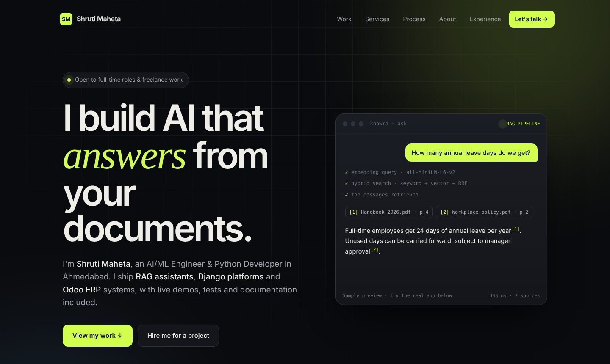

<div align="center">

# Shruti Maheta: Portfolio

**AI/ML Engineer & Python Developer · Ahmedabad, India**

RAG assistants · Django platforms · Odoo ERP

### [🌐 View the live portfolio →](https://shruti-maheta.vercel.app/)

[](mailto:mahetashruti6@gmail.com)
[](https://linkedin.com/in/shrutimaheta)
[](#-work-with-me)



</div>

---

## 👋 About me

I'm a Python developer focused on **AI and machine learning**. I build retrieval-augmented AI assistants, full-stack Django platforms and custom Odoo ERP modules, and I ship them with live demos, tests and documentation.

- 🎓 **Teaching Fellow** at DA-IICT, Gandhinagar (Python & Computer Networks labs)
- 💼 Previously **Python Developer Intern** at BizzAppDev Systems (Odoo ERP for a production legal case tracker)
- 📚 MCA, CHARUSAT (8.02) · BCA, BKNMU (9.03)

## 🚀 Featured projects

| Project | What it is | Stack | Links |
|---|---|---|---|
| **Knowra** | Team knowledge base that answers from company documents, with cited sources, version comparison and a knowledge map | FastAPI · PostgreSQL + pgvector · Sentence Transformers · Gemini | [Live app](https://knowra-ecru.vercel.app/) · [Code](https://github.com/Shrutimaheta/knowra) |
| **Legal Case Tracker** | Odoo 18 ERP for law firms: enquiries, cases, hearings, deadlines, billing and a client portal | Odoo 18 · Python · PostgreSQL | [Screenshots](https://github.com/Shrutimaheta/law-firm-erp/blob/main/docs/screenshots/README.md) · [Code](https://github.com/Shrutimaheta/law-firm-erp) |
| **Jeevan** | Hospital & clinic platform with patient, doctor, receptionist and nurse portals and consent-based records | Django · DRF · PostgreSQL · React · Scikit-learn | [Live demo](https://jeevan-demo.onrender.com/login/) · [Code](https://github.com/Shrutimaheta/Jeevan) |

More projects on the site: TA Academic Assistant (RAG), Customer Churn Prediction (ML), SheCares (Flutter), Recipe Book (Django) and Hotel Grace (Java).

## 🛠️ Skills

**AI/ML:** RAG, LLMs, embeddings, semantic search, FAISS, pgvector, Scikit-learn
**Backend:** Python, Django, Django REST Framework, FastAPI, Odoo ERP
**Data:** Pandas, NumPy, Matplotlib, Power BI
**Databases:** PostgreSQL, MySQL, SQLite, MongoDB
**Tools:** Git, GitHub Actions, Postman, Vercel, Render

## 🤝 Work with me

I'm open to **full-time AI/ML, Python and Odoo roles** (Ahmedabad, Gandhinagar or remote) and to **freelance projects**:

- 💬 AI document assistants (chatbots that answer from your PDFs, with sources)
- 🧩 Django web apps & REST APIs
- ⚙️ Odoo ERP customisation
- 📊 ML models & Power BI dashboards

📧 **mahetashruti6@gmail.com** · 💼 [linkedin.com/in/shrutimaheta](https://linkedin.com/in/shrutimaheta)

---

<details>
<summary><b>About this website</b></summary>

A fast static site: one `index.html` with hand-written HTML, CSS and vanilla JavaScript. It has no framework and no build step.

- Animated RAG demo in the hero section
- Project filters, image lightbox and scroll animations
- Responsive layout for desktop and mobile, respecting `prefers-reduced-motion`
- Hosted on GitHub Pages

```
├── index.html     # the whole site
├── img/           # project screenshots and preview
└── README.md
```

Run it locally by opening `index.html` in a browser.

</details>

<div align="center"><sub>© 2026 Shruti Maheta</sub></div>
